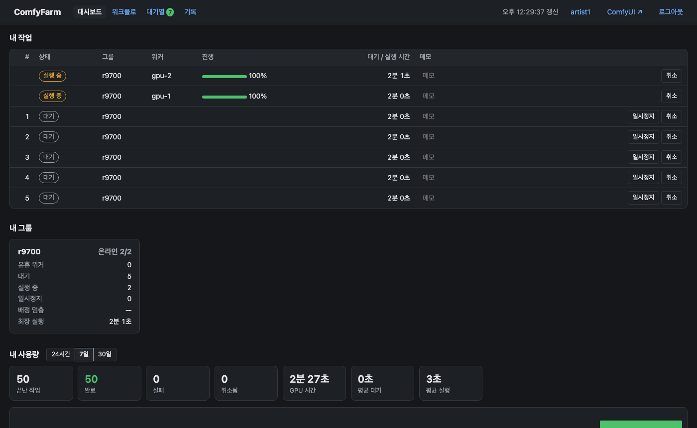

# ComfyFarm

[English](README.md) · 한국어

[ComfyUI](https://github.com/comfyanonymous/ComfyUI) GPU 워커 여러 대를 하나의 팜으로 묶는 작업 라우터입니다. CUDA와 ROCm
워커를 함께 쓸 수 있습니다. 사용자는 평소 쓰던 ComfyUI 화면을 그대로 쓰고, ComfyFarm은 작업을 대기열에 넣어 알맞은 유휴
워커에 배정하며, 진행 상황·미리보기·오류를 작업을 낸 브라우저로 돌려줍니다.

> **상태: 공개 전(pre-release).** M1–M4(배정 핵심, 이벤트와 게이트웨이, 모니터링, 계정과 그룹 권한이 있는 웹 UI, 롤링
> 업그레이드)가 구현되어 있습니다. CUDA/ROCm 혼합 인수 시험(M5)을 마친 뒤 첫 릴리스를 냅니다. 마일스톤별 내용은
> [로드맵](docs/design/12-roadmap.md)에 있습니다.

## 왜 또 하나인가

작업을 나눠 주는 일 자체는 쉽습니다. 어려운 것은 ComfyUI를 팜으로 돌리는 일입니다. ComfyUI는 한 사람이 쓰는 앱으로
만들어졌습니다. 큰 모델을 읽는 동안 이벤트 루프가 몇 분씩 멈추고, 같은 `clientId`로 WebSocket을 다시 연결하면 이후
이벤트가 조용히 사라지며, `/object_info`는 동기식이고, 사용자·대기열·기록이 한 프로세스 안에 있습니다. ComfyFarm의 설계는
이런 불일치를 ComfyUI나 그 프론트엔드를 포크하지 않고 피해 가는 결정들의 목록이며, 각 결정은 실제 운영에서 겪었거나 stock
ComfyUI로 재현한 구체적인 장애에 묶여 있습니다.

## 특징

- 작업이 사라지거나 두 번 돌지 않습니다: 라우터가 정하는 `prompt_id`, 배정 결과 분류, 유실 작업 감지.
- stock ComfyUI와 stock 프론트엔드를 그대로 씁니다. 선택 사항인 워커 커스텀 노드가 WebSocket 재연결 경쟁을 고칩니다
  ([ComfyUI 0.41.0에서 확인](docs/design/04-worker-protocol.md#ws-reconnect-race)).
- 몇 분씩 걸리는 모델 로딩을 견디는 "바쁨 대 죽음" 판정.
- 능력(백엔드·VRAM·OS)을 보고 배정하는 CUDA/ROCm 혼합 팜.
- 웹 UI(대시보드, 대기열, 기록, 관리; 라이트/다크; 한국어/영어), 사용자 계정과 사용자별 워커 그룹 권한, Prometheus용
  `/metrics`(모르는 값이 정상으로 읽히지 않도록 정의한 정체 지표).
- 워커를 한 대씩 롤링 업그레이드: 비우고, 검증하고, 실패하면 되돌립니다. 공유 계약 `comfy-upgrade/1`을 따르고, 게시된
  아티팩트가 아니면 거부하는 표준 라이브러리 전용 런처를 씁니다([설정](docs/guide/rollouts.md)).
- 안내형 워커 설치: 대시보드에 빈 리눅스 호스트를 적고, 그 호스트에서 검증된 명령 한 줄을 실행하면(또는 라우터가 ssh로
  대신 실행) 호스트 점검 결과를 보고 워커를 등록합니다([설계 14](docs/design/14-worker-setup.md)).
- 대시보드에서 노드팩 배포: 저장소를 추가하고 빌드해서 롤아웃합니다. 요구사항을 한 번에 해석하고, OpenCV는 한 벌만,
  서브모듈 포함, 커밋 고정, 운영자가 허용한 저장소에서만 받습니다([설계 15](docs/design/15-control-plane-builds.md)).
- Postgres 원장, 한 대 구성. 이중화(라우터 2대 + Postgres 복제)는 설계만 되어 있고 아직 구현 전입니다
  ([아키텍처](docs/design/01-architecture.md) C).

## 스크린샷

설치 리허설(빈 호스트에 라우터 1 + ROCm 워커 2 + UI 워커, 폐쇄망)에서 찍었습니다. 주소는 문서용 주소로 바꿨습니다. 테마는
기본값이 브라우저를 따르고(자동), 개인 설정에서 라이트/다크를 고를 수 있습니다.

| | |
|---|---|
|  **대시보드** — 내 작업, 그룹, 사용량 |  **워크플로** — 그룹 선택이 붙은 stock ComfyUI 화면 |
|  **대기열** — 워커 두 대가 돌고 나머지는 대기 |  **시스템 → 워커** |
|  **워커 설치** — 빈 호스트에서 실행할 검증된 명령 한 줄 |  **호스트 점검** — 드라이버, 디렉터리, venv, 시계, 라우터 |
|  **롤아웃** — 인스턴스, 프로필, 감사 로그 |  **통계** — 그룹·사용자·워커별 |

## 빠른 시작

ComfyFarm은 콘텐츠를 조직 네트워크 밖으로 내보낼 수 없는 곳을 위한 것입니다. 제어 호스트 한 대, NAS, ComfyUI를 돌리는 GPU
머신 몇 대로 이루어집니다. 설치는 엔지니어(또는 AI 어시스턴트)가 오후 한나절이면 되고, 그 뒤 운영은 대시보드에서 합니다.

1. **제어 영역** — 라우터·게이트웨이·Postgres·빌더·UI 워커. 미리 고칠 파일이 없습니다.
   ```sh
   git clone https://github.com/frozenrainy/comfyfarm && cd comfyfarm/deploy/easy
   docker compose up -d
   docker compose logs router | grep "setup code"      # http://<이 호스트>:8080 을 열고 이 코드로 관리자를 만듭니다
   ```
   첫 기동이 UI 워커용 ComfyUI를 빌드하고 띄웁니다. GPU 워커가 없어도 워크플로가 열립니다.
   보안을 엄격하게(비밀값은 호스트에, 포트는 주소 하나에, 버전 고정): `deploy/compose/`, 컨테이너 없이: `deploy/systemd/`
   (빌더·UI 워커 컨테이너 없음) — [설치](docs/guide/install.md) §1.
2. **노드팩과 GPU 워커** — *시스템 → 롤아웃*에서 노드팩을 추가하고, GPU 종류에 맞게 *빌드*하고, 프로필을 만듭니다. 그다음
   *시스템 → 워커 → 워커 설치*로 빈 리눅스 호스트를 점검된 워커로 만듭니다.
3. **점검** — `docker compose exec router comfyfarm doctor`가 아직 맞지 않은 것을 한 줄씩 알려 줍니다.

안내서(영문): [설치](docs/guide/install.md) · [운영](docs/guide/running.md) · [롤링 업그레이드](docs/guide/rollouts.md) ·
[커스텀 노드](docs/guide/custom-nodes.md) · [백업](docs/guide/backup.md) · 보안 신고: [SECURITY.md](SECURITY.md)

화면 언어는 개인 설정에서 고릅니다(자동 = 브라우저 언어). 서버가 돌려주는 오류 문구는 로그·문서와 맞추려고 영어로 둡니다.

## 문서

[docs/design/00-overview.md](docs/design/00-overview.md)와 [결정 기록](docs/design/decisions.md)부터 보세요. 설계 문서와
안내서는 영어로 씁니다.

## 라이선스

ComfyFarm은 코드가 ComfyUI와 만나는 경계를 따라 두 라이선스로 나뉩니다.

| 부분 | 라이선스 | 이유 |
|---|---|---|
| 라우터, 게이트웨이, 대시보드, 런처, 에이전트, 게시 도구 — `src/` 아래 전부 | Apache-2.0 ([LICENSE](LICENSE)) | HTTP/WebSocket으로 ComfyUI와 통신하는 별개 프로그램 |
| `worker_ext/comfyfarm_worker`(ComfyUI 안에서 돌고 ComfyUI에서 파생한 코드를 포함)와 `ui_ext/comfyfarm_ui`(ComfyUI 프론트엔드 확장) | GPL-3.0-or-later (각 디렉터리의 LICENSE) | GPL-3.0 프로그램([ComfyUI](https://github.com/comfyanonymous/ComfyUI), [ComfyUI_frontend](https://github.com/Comfy-Org/ComfyUI_frontend))을 확장 |

라우터는 두 확장 중 어느 것도 import하지 않습니다. 확장은 워커에 ComfyUI 커스텀 노드로 설치됩니다.
