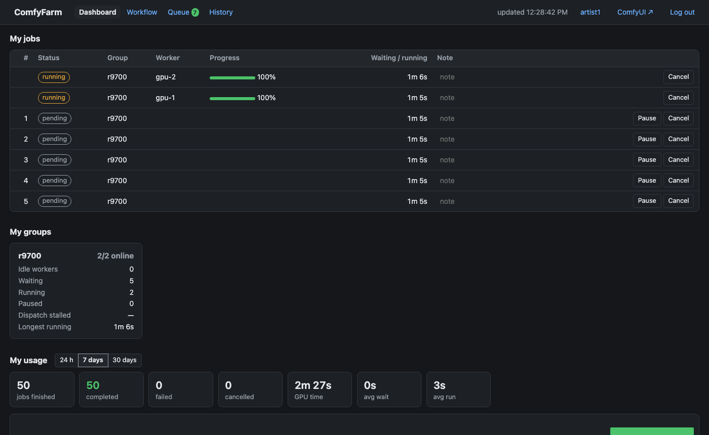
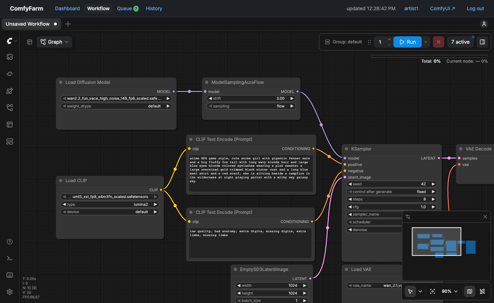
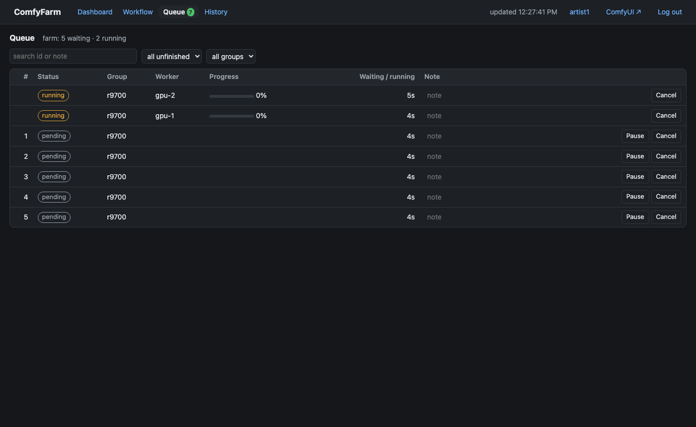
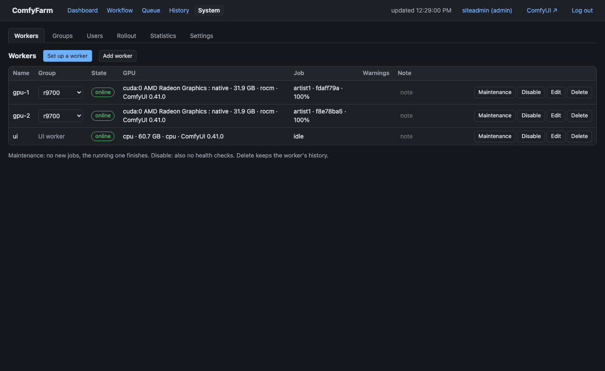
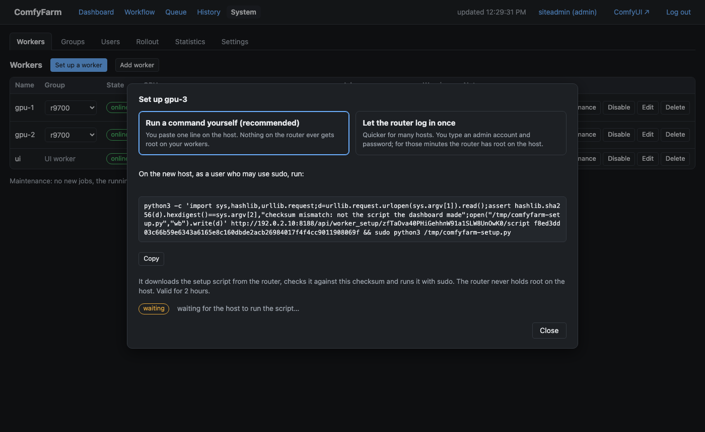
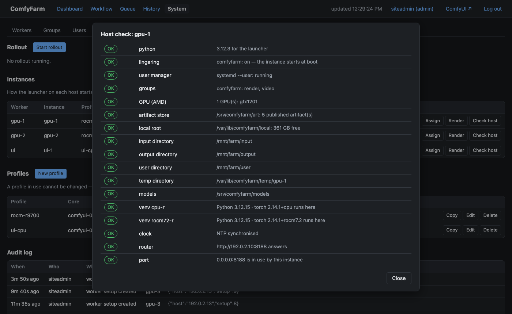
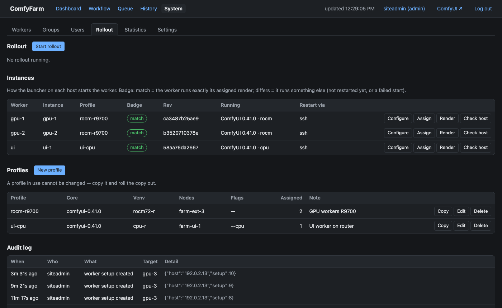
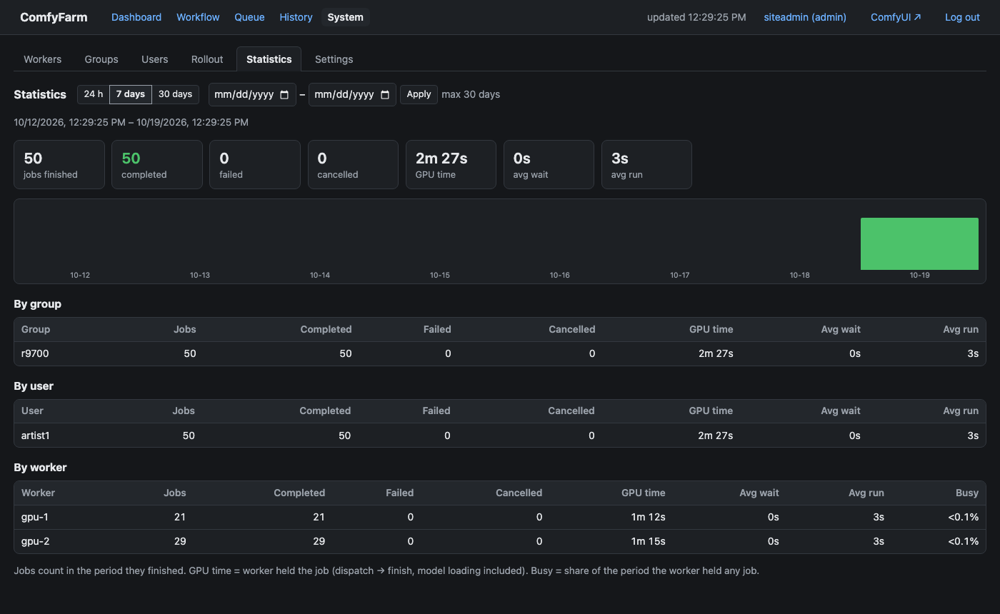

# ComfyFarm

English · [한국어](README.ko.md)

A job router for a farm of [ComfyUI](https://github.com/comfyanonymous/ComfyUI) GPU workers — CUDA and ROCm side by
side. Users keep the stock ComfyUI frontend; ComfyFarm queues their jobs, hands each one to a suitable idle worker, and
relays progress, previews and errors back to the browser that submitted it.

> **Status: pre-release.** Milestones M1–M4 are implemented (core dispatch, events + gateway, monitoring, web UI with
> accounts and group permissions, rolling upgrades); the mixed CUDA/ROCm acceptance run (M5) comes before a first
> release. See the
> [roadmap](docs/design/12-roadmap.md) for what each milestone contains.

## Why another one?

Dispatching jobs is easy. Running ComfyUI as a farm is not, because ComfyUI is built as a single-user app: its event
loop stops for minutes while it loads a large model, a WebSocket reconnect with the same `clientId` silently drops all
further events, `/object_info` is synchronous, and users, queue and history live inside one process. ComfyFarm's
design is a catalogue of decisions — each tied to a concrete failure seen in production or reproduced against stock
ComfyUI — about how to route around those mismatches without forking ComfyUI or its frontend.

## Highlights

- No lost or duplicated jobs: router-chosen `prompt_id`, classified dispatch outcomes, lost-job detection.
- Stock ComfyUI and stock frontend; an optional worker custom node fixes the WebSocket reconnect race
  ([verified on ComfyUI 0.41.0](docs/design/04-worker-protocol.md#ws-reconnect-race)).
- Busy-vs-dead worker health that tolerates multi-minute model loads.
- Mixed CUDA/ROCm farms with capability-aware routing.
- A web UI (dashboard, queue, history, administration; light/dark; English/Korean) with user accounts and per-user worker-group
  permissions, and `/metrics` for Prometheus with stall numbers defined so that an unknown value never reads as healthy.
- Rolling ComfyUI upgrades one worker at a time — drained, verified, reverted on failure — via the shared
  `comfy-upgrade/1` contract, with a stdlib-only launcher that refuses anything but published artifacts
  ([setup](docs/guide/rollouts.md)).
- Guided worker setup: describe an empty Linux host in the dashboard, run one checked command on it (or let the
  router do it over ssh), read the host check, add the worker ([design 14](docs/design/14-worker-setup.md)).
- Postgres ledger on a single box. High availability (two routers, Postgres replication) is designed, not built yet
  ([architecture](docs/design/01-architecture.md) C).

## Screenshots

From the install rehearsal (1 router + 2 ROCm workers + a UI worker on empty hosts, closed network); addresses replaced
with documentation ones. The theme follows the browser by default (light/dark in personal settings).

| | |
|---|---|
|  **Dashboard** — the user's jobs, groups and usage |  **Workflow** — stock ComfyUI frontend with a group picker |
|  **Queue** — two workers busy, the rest waiting |  **System → Workers** |
|  **Set up a worker** — one checked command for an empty host |  **Host check** — driver, directories, venvs, clock, router |
|  **Rollout** — instances, profiles, audit log |  **Statistics** — per group, user and worker |

## Quick start

ComfyFarm is for a site that keeps its content inside its own network: one control-plane host, a NAS, a handful of
GPU machines running ComfyUI. Installing takes an engineer (or an AI assistant) an afternoon; running it afterwards
is the dashboard.

1. **Control plane** — router, gateway and Postgres, nothing to edit first:
   ```sh
   git clone https://github.com/frozenrainy/comfyfarm && cd comfyfarm/deploy/easy
   docker compose up -d
   docker compose logs router | grep "setup code"      # open http://<this host>:8080 and create the administrator
   ```
   Hardened instead (secrets on the host, ports on one address, pinned versions): `deploy/compose/`; without
   containers: `deploy/systemd/` — [install](docs/guide/install.md) §1.
2. **Workers** — publish ComfyUI, a venv and node sets once ([rolling upgrades](docs/guide/rollouts.md) §1), then
   *System → Workers → Set up a worker* turns each empty Linux host into a checked worker: the UI worker first, then
   the GPU machines.
3. **Check** — `docker compose exec router comfyfarm doctor` tells you, line by line, what is not right yet.

Guides: [install](docs/guide/install.md) · [running](docs/guide/running.md) · [rolling upgrades](docs/guide/rollouts.md) ·
[custom nodes](docs/guide/custom-nodes.md) · [backup](docs/guide/backup.md) · security reports: [SECURITY.md](SECURITY.md)

## Documents

Start with [docs/design/00-overview.md](docs/design/00-overview.md) and the [decision log](docs/design/decisions.md).

## License

ComfyFarm is two licences, split along the line where code meets ComfyUI:

| Part | Licence | Why |
|---|---|---|
| router, gateway, dashboard, launcher, agent, publisher — everything under `src/` | Apache-2.0 ([LICENSE](LICENSE)) | separate programs that talk to ComfyUI over HTTP/WebSocket |
| `worker_ext/comfyfarm_worker` (runs inside ComfyUI, contains code derived from ComfyUI) and `ui_ext/comfyfarm_ui` (an extension of the ComfyUI frontend) | GPL-3.0-or-later (LICENSE in each directory) | they extend GPL-3.0 programs ([ComfyUI](https://github.com/comfyanonymous/ComfyUI), [ComfyUI_frontend](https://github.com/Comfy-Org/ComfyUI_frontend)) |

The router never imports either extension; they are installed on the workers as ComfyUI custom nodes.
